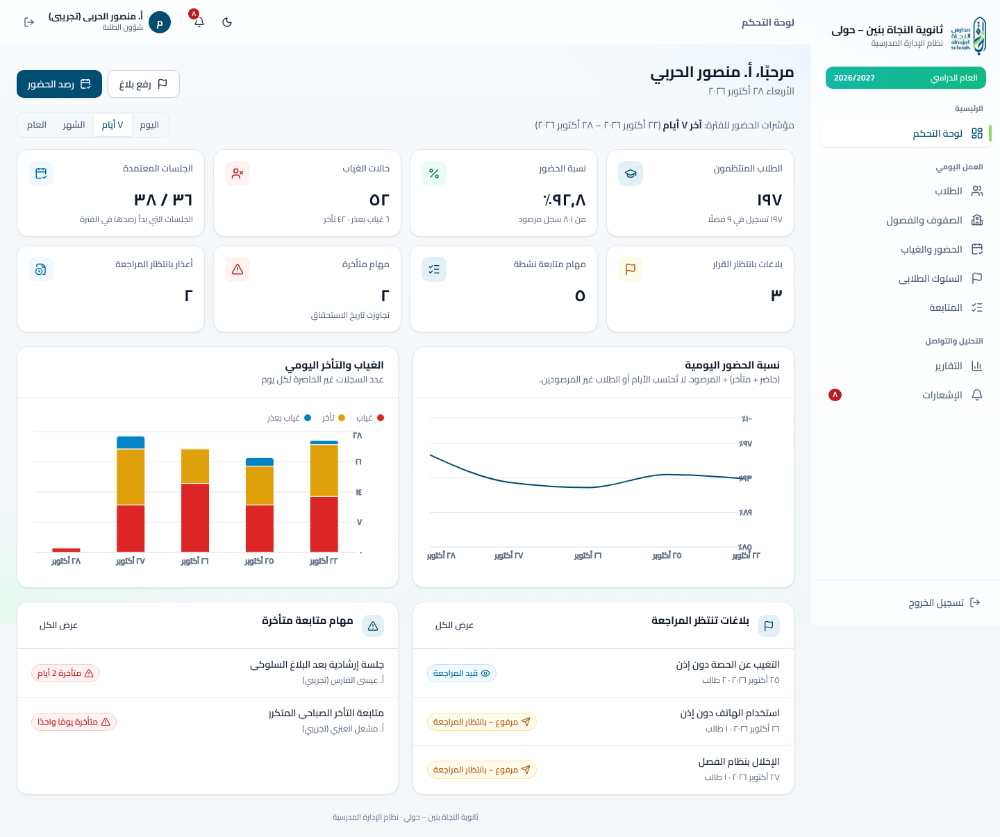

# نظام الإدارة المدرسية — ثانوية النجاة بنين – حولي

School management platform for **Al-Najat Boys Secondary School, Hawally (Kuwait)**: an Arabic-first, RTL web app for administration, Student Affairs, and teachers.



## Features

| Area | What works |
|---|---|
| Sign-in & roles | Supabase Auth, session restore/expiry, protected routes, `admin` / `student_affairs` / `teacher`, permission-aware navigation |
| Students | Paginated, Arabic-normalised search; filters (year, grade, class, status); create/edit/archive/reactivate; profile with attendance stats, history, behaviour, follow-ups, enrollment history; enrol/transfer (history preserved) |
| Classes & years | Classes by grade with occupancy and homeroom; class roster with per-student rates; teacher assignment; academic years (no overlap, one current) |
| Attendance | Daily **or** per-period mode (setting); per-day completion overview; batch marking with "mark rest present"; unmarked ≠ absent; submit requires completeness; reason-logged corrections; manager reopen; late-submission flag; history; unsaved-change guards |
| Excuses | File (teacher/SA), review (SA/admin); approval converts covered absences to excused with a correction trail |
| Behaviour | Multi-student incidents, configurable categories, severity, enforced lifecycle (submitted → under review → approved/rejected → resolved), no self-review, documented decisions, full timeline |
| Follow-ups | Assignment, priority, due-date states (overdue shown with icon + words), status flow, outcome, notes; links to students and incidents |
| Dashboards | Manager: KPIs for a selectable range, validated charts, pending reviews, overdue tasks. Teacher: today's sessions, own tasks, own reports |
| Notifications | Database-backed; read/unread/delete; 60-second refresh; no sensitive content |
| Reports | Student attendance, class summary, daily trend, behaviour (category × status), follow-ups by assignee; UTF-8 BOM CSV; print layout; same RLS scope as the screen |
| Admin | Users (create via Edge Function, grant/revoke roles, activate/deactivate, reset password), school settings, behaviour categories, immutable audit log viewer |

**Out of scope (by design):** student/parent portals, mobile apps, SMS/WhatsApp, payments, automatic disciplinary decisions, government-system integrations.

## Stack

React 19 + TypeScript (strict) + Vite 8 · React Router 8 · Tailwind CSS 4 with design tokens · shadcn-style primitives on Radix (`radix-ui`) · Lucide · TanStack Query 5 · React Hook Form + Zod 4 · Recharts 3 · Supabase (Auth, Postgres, RLS, Edge Functions) · Vitest + Testing Library · Playwright.

```
src/
  auth/            AuthProvider (session, roles from DB), route guards
  components/ui/   design-system primitives (button, field, table, dialog, badges, states…)
  components/      layout (AppShell, Logo), StudentPicker
  features/<area>/ pages + feature data hooks (students, classes, attendance, behavior,
                   followups, dashboard, notifications, reports, users, settings, audit)
  lib/             supabase client, generated DB types, format (Kuwait dates), csv, errors,
                   queries, domain/ (attendance, behavior, followups, permissions, reports)
supabase/
  migrations/      versioned schema, RLS, workflows, reporting
  functions/       admin-users Edge Function (service role stays server-side)
  seed.sql         fictional reference data (local db reset only)
scripts/seed-dev.mjs   fictional staff accounts + demo records (localhost only)
tests/integration/     API-level RLS & workflow tests against local Supabase
tests/e2e/             Playwright end-to-end tests
docs/                  brand-audit, database, security
```

## Getting started (local)

Requirements: Node 20+ (tested with 22), Docker (for the local Supabase stack).

```bash
npm install
npx supabase start                 # Postgres, Auth, REST, Edge runtime (first run pulls images)
npx supabase db reset              # applies migrations + supabase/seed.sql (fictional data)
npm run seed:dev                   # fictional staff accounts + attendance/incidents/follow-ups

# point the frontend at the local stack (public values only):
cp .env.example .env.local
#   VITE_SUPABASE_URL=http://127.0.0.1:54321
#   VITE_SUPABASE_ANON_KEY=<ANON_KEY from `npx supabase status`>

npm run dev                        # http://127.0.0.1:5173
```

### Local test accounts (fictional, development only)

Password for all: `Najat-Dev-2026!` (override with `DEV_SEED_PASSWORD` when running `seed:dev`).

| Role | Email | Notes |
|---|---|---|
| Admin | `admin@najat.test` | |
| Student Affairs | `affairs@najat.test`, `affairs2@najat.test` | two reviewers, so self-review rules can be exercised |
| Teacher | `teacher1@najat.test` | classes 10/1, 10/2, 11/2, 11/3 |
| Teacher | `teacher2@najat.test`, `teacher3@najat.test` | other classes |
| Teacher | `teacher4@najat.test` | **no classes** (authorization checks) |

All names, numbers (`NJ-…`), and phones (`+965 5550 …`, a deliberately unallocated prefix) are fictional. The seed script refuses to run against a non-localhost Supabase.

## Commands

| Command | What it does |
|---|---|
| `npm run dev` | Vite dev server |
| `npm run typecheck` | `tsc -b` (app + tests + configs, strict) |
| `npm run lint` | oxlint |
| `npm test` | unit + component tests (Vitest, jsdom) |
| `npm run test:integration` | RLS & workflow tests against **local** Supabase |
| `npm run test:e2e` | Playwright (starts/reuses the dev server; needs local Supabase + seed) |
| `npm run build` | type-check + production build to `dist/` |
| `npm run check` | typecheck + lint + unit tests + build |
| `npm run db:reset` / `npm run seed:dev` | fresh fictional data |
| `npm run db:types` | regenerate `src/lib/database.types.ts` from the local schema |

Recommended full verification: `npx supabase db reset && npm run seed:dev && npm run check && npm run test:integration && npm run test:e2e`.

## Deploying to a hosted Supabase project

1. Create the project. In **Authentication → Providers → Email**, keep email enabled and **disable "Allow new users to sign up"**. Set the Site URL to your frontend origin.
2. Link and push the schema (migrations only; **the seed is not pushed**):
   ```bash
   npx supabase link --project-ref <ref>
   npx supabase db push
   npx supabase functions deploy admin-users
   npx supabase secrets set ALLOWED_ORIGIN=https://your-frontend.example
   ```
3. Create the first administrator (one-time, from a trusted machine). Create the user in **Authentication → Users** (the `handle_new_user` trigger creates the profile), then in the SQL editor:
   ```sql
   insert into public.user_roles (user_id, role) select id, 'admin' from auth.users where email = 'principal@your-school.edu.kw';
   ```
   After that, manage everyone else from **المستخدمون والصلاحيات** in the app.
4. In the app's **الإعدادات**: create the academic year, set it as current, then add classes, students, and teacher assignments.
5. Build the frontend with `VITE_SUPABASE_URL` and `VITE_SUPABASE_ANON_KEY` (public values only), and host `dist/` on any static host with SPA fallback to `index.html`.

Never put the service-role key, a secret key, or the database password in any `VITE_*` variable.

## Documentation

* [`docs/brand-audit.md`](docs/brand-audit.md): reference-site audit, logo usage, colours, typography, design-system decisions, validated chart palette
* [`docs/database.md`](docs/database.md): schema, constraints, business rules, reporting rules
* [`docs/security.md`](docs/security.md): permission matrix, RLS, privileged operations, privacy, env vars

## Known limitations

* Due-soon follow-up reminders are generated when the assignee opens the app (no background scheduler is configured). Supabase `pg_cron` could call the same logic on a schedule.
* Notifications refresh by polling (60 s), not Realtime.
* The student attendance report returns all matching rows in one response (no server-side pagination); appropriate for a single school.
* Kuwaiti public holidays are not modelled; only the Friday/Saturday weekend is blocked.
* User invitations use an admin-set temporary password; email invites/SMTP are not configured.
